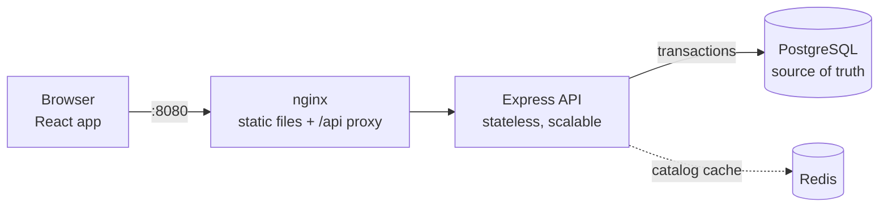

# QuickKart

A multi-store quick-commerce platform, inspired by 10-minute grocery delivery apps.
Customers order from their nearest dark store and pick a 30-minute delivery slot; store
staff manage stock, slots and orders. Built to show what goes wrong when many people
buy the same thing at once, and how to prevent it.


**Stack:** React + TypeScript (Vite, React Router, TanStack Query) · Node.js 24 + Express 5 ·
PostgreSQL 18 · Redis · Docker Compose · nginx · Vitest · k6

## What it does

- **Shop**: browse 50,000 products across 3 stores, search, filter by aisle, cart, checkout
  with delivery slots, order history, cancel before dispatch. Works on phones.
- **Admin**: move orders through packed → out for delivery → delivered, adjust stock and
  prices, hide products, open delivery slots, see sales and best sellers.

| Checkout | Order tracking |
|---|---|
|  |  |

| Admin: orders | Admin: sales |
|---|---|
|  |  |

## Engineering challenges solved

| Problem | What could go wrong | Solution | Proof |
|---|---|---|---|
| Last item purchased twice | 10 people buy the last carton; all 10 succeed | Atomic conditional `UPDATE … WHERE stock >= qty` inside one transaction, fixed lock order | [race demo](api/test/race-demo.test.ts), [checkout tests](api/test/checkout.test.ts) |
| Duplicate checkout requests | The phone retries after a timeout and the customer is charged twice | Idempotency keys, saved in the same transaction as the order | checkout tests 3–5 |
| Too many delivery bookings | A slot for 5 gets 8 orders | Atomic `UPDATE … WHERE booked < capacity` + `CHECK (booked <= capacity)` | checkout test 2 |
| Same product in different stores | Prices and stock differ per store | `store_inventory` junction table keyed by (store, product) | [schema](db/init/001_schema.sql) |
| Slow product search | Every search scans 50,000 products | Trigram index (19 ms → 0.5 ms for a rare term), keyset pagination | [EXPLAIN script](db/queries/search-explain.sql) |
| Repeated expensive reads | Popular searches sort hundreds of rows every time | Redis cache-aside with versioned keys; checkout never reads the cache | [cache tests](api/test/cache.test.ts) |
| Setup differs between machines | "Works on my machine" | Docker Compose: one command, health checks, volumes | [docker-compose.yml](docker-compose.yml) |

### The race condition, live

```bash
cd api && npm run demo:race
```
```
NAIVE: 10 buyers, 1 in stock -> 10 orders created, stock now 0   <-- OVERSOLD by 9
REAL:  10 buyers, 1 in stock -> 1 order created, 9 told "out of stock", stock now 0   <-- CORRECT
```
The naive version reads stock, checks it, then writes. All 10 requests read "1" before any
of them writes (a *lost update*). The real version checks inside the UPDATE: PostgreSQL locks
the row, makes the next request wait, then re-checks the condition on the new value.

## Performance

k6 load tests through nginx, Docker on a laptop ([details](docs/performance.md)):

| Scenario | Result |
|---|---|
| 50 shoppers browsing, cache on / off | p95 **7.7 ms** / 14.1 ms, 0 errors |
| Flash sale on ONE product, 20 orders/s | 901/901 orders placed, p95 16 ms |
| Flash sale on ONE product, 50 orders/s | **2,250/2,250 placed, no oversell**, p95 46 ms |
| Search "paneer", 50 concurrent connections | 155 req/s → **3,061 req/s** with Redis |

The jump from 16 ms to 46 ms is **hot-row contention**: every flash-sale order locks the same
stock row, so they go one at a time. More API servers can't fix that; [scaling.md](docs/scaling.md)
explains what would.

## Architecture



More diagrams (data model, checkout sequence, order state machine): [docs/architecture.md](docs/architecture.md).
Design decisions and their trade-offs: [docs/adr/](docs/adr/).

## Run it

### With Docker (one command)

You need Docker Desktop and Git.
```bash
cp .env.example .env
docker compose up -d --build
docker compose exec -T db psql -U quickkart -d quickkart < db/seed/seed.sql   # sample data, once
```
Open **http://localhost:8080**. To use the admin area, register on the site, then run
`bash scripts/make-admin.sh you@example.com` and log in again.

| Service | Role | Reachable at |
|---|---|---|
| web | nginx: serves the React app, forwards `/api` | http://localhost:8080 |
| api | Express API; scale with `docker compose up -d --scale api=3` | only through nginx |
| db | PostgreSQL 18, data in the `pgdata` volume | localhost:5432 |
| redis | catalog cache | inside Docker only |
| k6 | load tester | `bash scripts/load-test.sh catalog` or `checkout` |

### For development (live reload)

You need Node.js 24 too.
```bash
cp .env.example .env && cp api/.env.example api/.env
docker compose up -d db
docker compose exec -T db psql -U quickkart -d quickkart < db/seed/seed.sql
cd api && npm install && npm run dev        # http://localhost:4000/api/health
cd web && npm install && npm run dev        # http://localhost:5173 (second terminal)
```
Wipe all data and reload the samples: `bash scripts/reset-data.sh`.

## Tests

```bash
docker compose --profile test up -d db-test   # throwaway test database
cd api && npm test                            # 60 API tests: auth, catalog, checkout, orders, admin
cd web && npm test                            # cart logic
```
Concurrency tests fire 10 simultaneous requests and check the database afterwards.
Redis tests run when a Redis is available: `TEST_REDIS_URL=redis://localhost:6380 npm test`.

<details>
<summary><b>API reference</b></summary>

| Method | Path | Auth | Success | Errors |
|---|---|---|---|---|
| GET | /api/health | – | 200 | 500 |
| POST | /api/auth/register | – | 201 | 400, 409 |
| POST | /api/auth/login | – | 200 | 400, 401 |
| POST | /api/auth/logout | user | 204 | 401 |
| GET | /api/auth/me | user | 200 | 401 |
| GET | /api/stores | – | 200 | |
| GET | /api/categories | – | 200 | |
| GET | /api/stores/:storeId/slots | – | 200 | 400, 404 |
| GET | /api/stores/:storeId/products?q=&category=&limit=&cursor= | – | 200 | 400, 404 |
| POST | /api/orders (header `Idempotency-Key`) | user | 201 | 400, 401, 409, 422 |
| GET | /api/orders | user | 200 | 401 |
| GET | /api/orders/:id | owner | 200 | 401, 404 |
| POST | /api/orders/:id/cancel | owner | 200 | 401, 404, 409 |
| GET | /api/admin/stores/:storeId/inventory | admin | 200 | 401, 403, 404 |
| PATCH | /api/admin/stores/:storeId/inventory/:productId | admin | 200 | 400, 403, 404, 409 |
| POST | /api/admin/stores/:storeId/slots | admin | 201 | 400, 403, 409 |
| GET | /api/admin/orders, /api/admin/orders/:id | admin | 200 | 401, 403, 404 |
| PATCH | /api/admin/orders/:id/status | admin | 200 | 400, 403, 404, 409 |
| GET | /api/admin/reports/sales, /top-products, /slots | admin | 200 | 400, 403 |

401 = not logged in; 403 = logged in but not allowed; 404 for someone else's order (doesn't
reveal that it exists); 409 = valid request that conflicts with current state.
</details>

<details>
<summary><b>Project structure</b></summary>

```
api/src/
  modules/auth       register, login, sessions (Argon2id, JWT in httpOnly cookie)
  modules/catalog    stores, aisles, slots, search with keyset pagination + cache
  modules/orders     checkout (placeOrder.ts), history, cancel
  modules/admin      inventory, slots, order status, reports
  db.ts              pool, withTransaction, withRetry
  cache.ts           Redis cache-aside with safe fallback
api/test/            Vitest + Supertest, including concurrency tests
web/src/             React app: features (auth, store, cart), pages (shop, checkout, orders, admin)
db/init/             schema, indexes (applied to a fresh database)
db/seed/             50,000 realistic sample products
load/                k6 scripts: catalog browsing, flash-sale checkout
scripts/             load-test, reset-data, make-admin, try-checkout
docs/                architecture, ADRs, performance, scaling
```
</details>

## What I'd do next

- Database migrations with a migration tool instead of init scripts.
- Payments as a separate step (order `PENDING_PAYMENT` → `PLACED` on webhook), notifications
  via a transactional outbox.
- Split hot stock into buckets for flash sales ([scaling.md](docs/scaling.md)).
- CI on GitHub Actions running both test suites on every push.
- Scheduled clean-up of idempotency keys older than 24 hours.
