# QuickKart

[](https://github.com/revant123/quickkart/actions/workflows/ci.yml)

**Live demo: [quickkart-acdk.onrender.com](https://quickkart-acdk.onrender.com)** (free hosting: the first visit after a quiet spell takes about a minute to wake up)

A multi-store quick-commerce platform, inspired by 10-minute grocery delivery apps.
Customers find the dark store that delivers to them, pick a 30-minute delivery slot, and pay
online (Razorpay) or in cash; store staff pack orders and riders deliver them. Built to show what goes wrong when many people
buy the same thing at once, and how to prevent it.

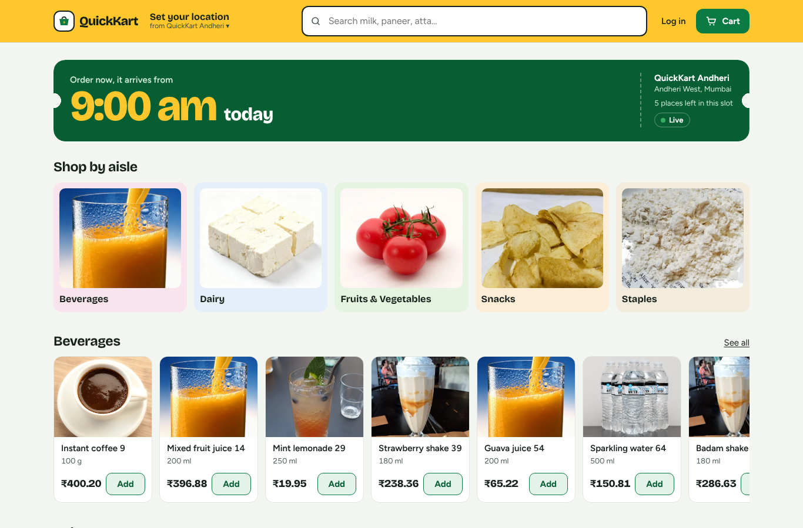

**Stack:** React + TypeScript (Vite, React Router, TanStack Query) · Node.js 24 + Express 5 ·
PostgreSQL 18 · Redis · Docker Compose · nginx · Vitest · k6

## What it does

- **Shop**: browse 50,000 products across 3 stores, search, filter by aisle, cart, checkout
  with delivery slots, order history, cancel before dispatch. Works on phones.
- **Location**: find the store that delivers to you by GPS or pincode (7 km radius); saved
  addresses with one default; checkout refuses addresses a store can't reach.
- **Payments**: pay online with Razorpay (test mode) or cash on delivery. Unpaid orders
  release their stock after 15 minutes; money for a cancelled order is refunded automatically.
- **Accounts**: email verification, password reset by email, "log out of all devices".
- **Notifications**: emails and SMS for every step (placed, on its way with the rider's name,
  delivered, cancelled, refunded), sent through a transactional outbox with retries.
- **Riders**: a phone-friendly Deliveries page; riders pick up packed orders (one rider per
  order, even if five tap at once), get directions, mark delivered and cash collected.
- **Live**: stock, "only 3 left" warnings, delivery-slot places and order status update on
  screen the moment they change, with no reload. If an item in your cart sells out, the
  cart tells you.
- **Pictures**: a real photo for each of the 40 product kinds (freely licensed, from
  Wikimedia Commons, credited on the Photo credits page); staff can upload their own photo
  for any product.
- **Admin**: move orders through packed → out for delivery → delivered (new orders appear
  live), adjust stock and prices, upload photos, hide products, open delivery slots, see
  sales and best sellers.

| Checkout | Order tracking |
|---|---|
| 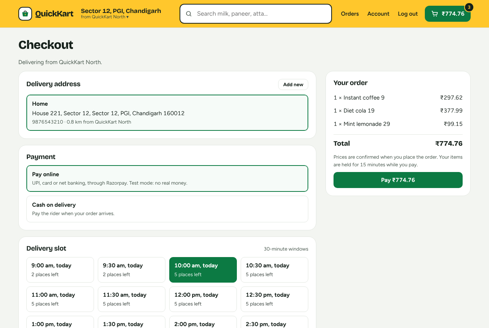 | 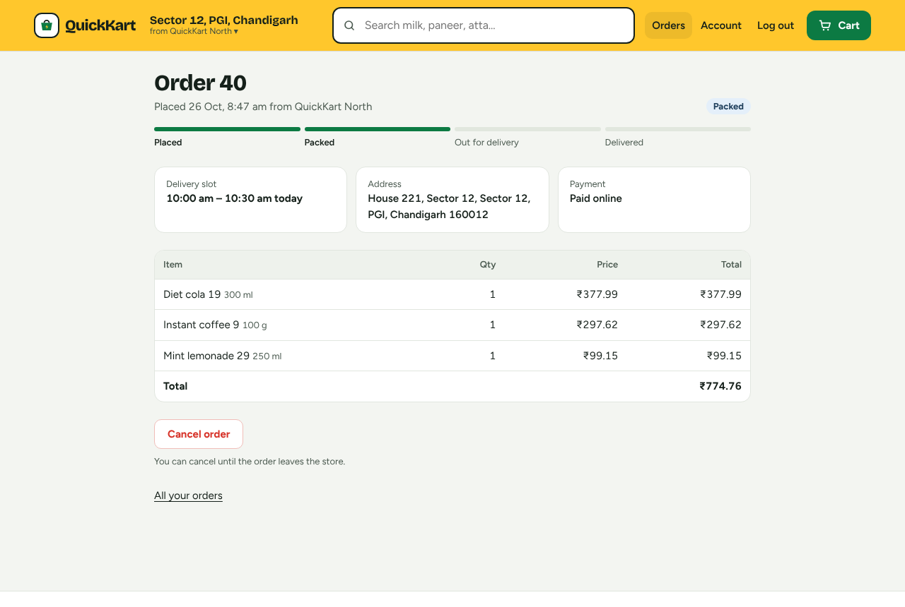 |

| Admin: orders | Admin: sales |
|---|---|
| 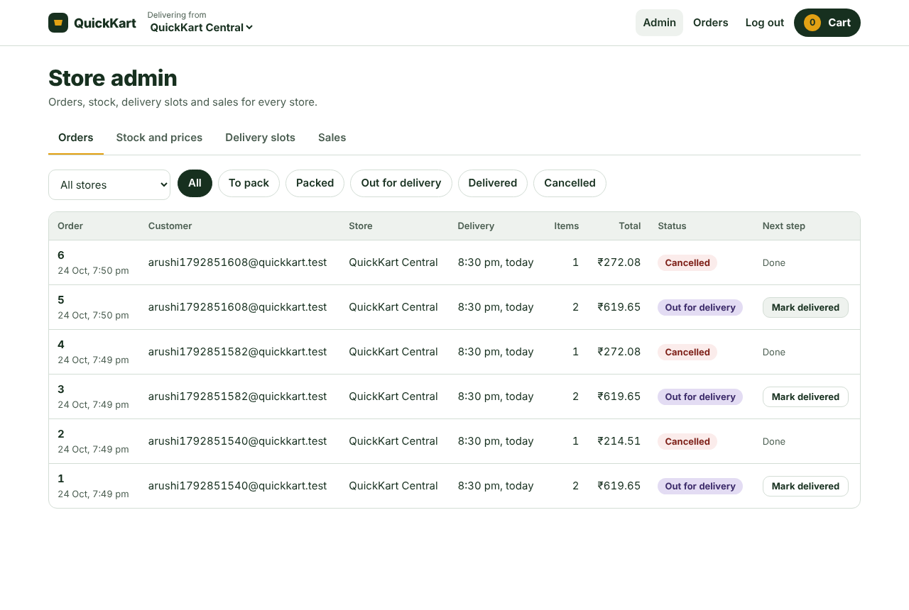 | 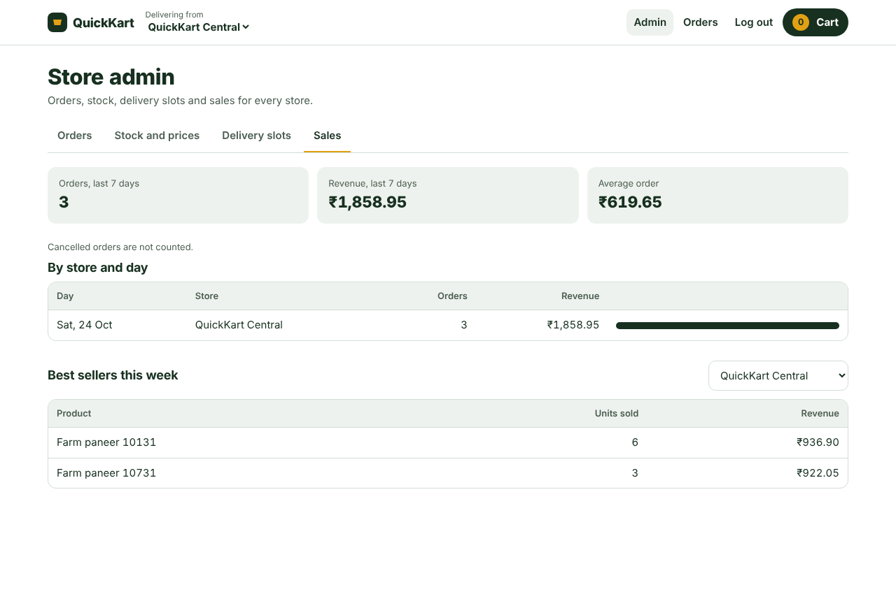 |

| Live: another shopper bought the last one | Admin: stock, prices and photos |
|---|---|
| 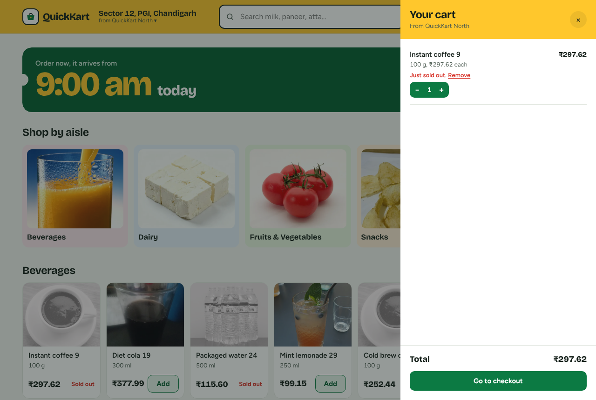 | 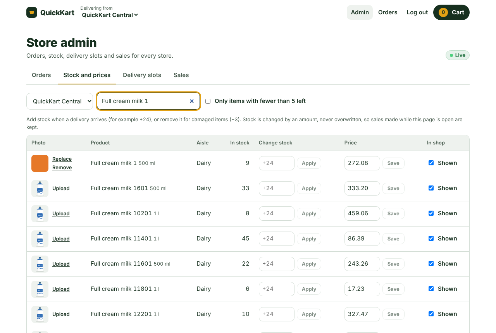 |

| Nearest store by pincode or GPS | Waiting for payment, items held |
|---|---|
| 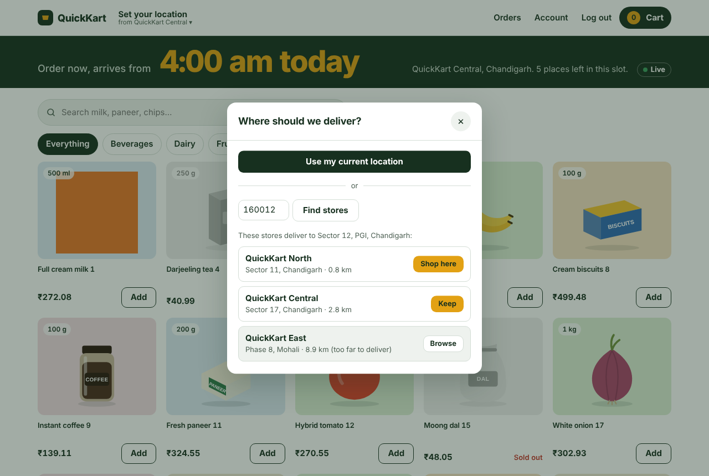 | 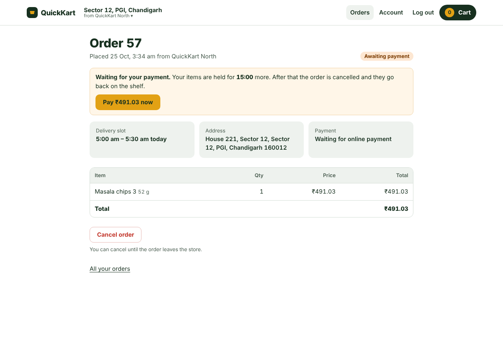 |

| Rider's phone | Every email and SMS, in the test inbox |
|---|---|
| 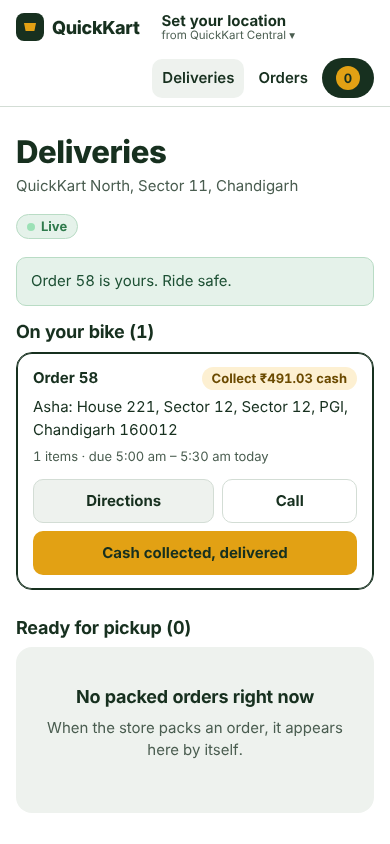 | 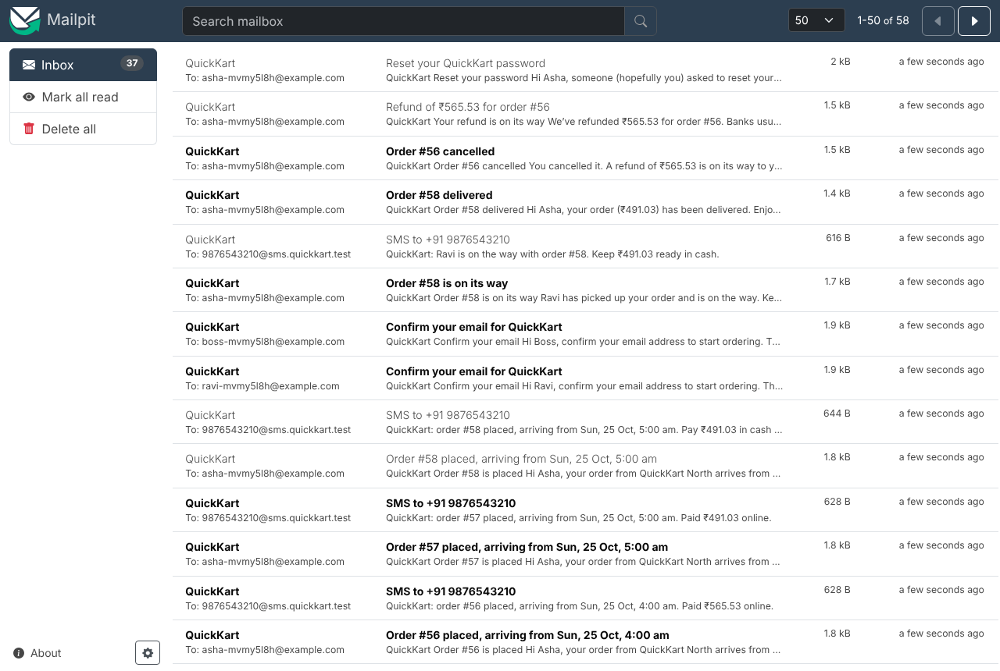 |

## Engineering challenges solved

| Problem | What could go wrong | Solution | Proof |
|---|---|---|---|
| Last item purchased twice | 10 people buy the last carton; all 10 succeed | Atomic conditional `UPDATE … WHERE stock >= qty` inside one transaction, fixed lock order | [race demo](api/test/race-demo.test.ts), [checkout tests](api/test/checkout.test.ts) |
| Duplicate checkout requests | The phone retries after a timeout and the customer is charged twice | Idempotency keys, saved in the same transaction as the order | checkout tests 3–5 |
| Too many delivery bookings | A slot for 5 gets 8 orders | Atomic `UPDATE … WHERE booked < capacity` + `CHECK (booked <= capacity)` | checkout test 2 |
| Same product in different stores | Prices and stock differ per store | `store_inventory` junction table keyed by (store, product) | [schema](api/migrations/0001_baseline.sql) |
| Slow product search | Every search scans 50,000 products | Trigram index (19 ms → 0.5 ms for a rare term), keyset pagination | [EXPLAIN script](db/queries/search-explain.sql) |
| Repeated expensive reads | Popular searches sort hundreds of rows every time | Redis cache-aside with versioned keys; checkout never reads the cache | [cache tests](api/test/cache.test.ts) |
| Setup differs between machines | "Works on my machine" | Docker Compose: one command, health checks, volumes | [docker-compose.yml](docker-compose.yml) |
| Shoppers see out-of-date stock | Someone buys an item another shopper is looking at | `pg_notify` inside the transaction (sent only on commit) → `LISTEN` in every API container → Server-Sent Events to browsers | [live tests](api/test/live.test.ts) |
| Password guessing and abuse | Bots hammer login or checkout | Rate limits shared across containers via Redis; 429 with `RateLimit` headers | [security tests](api/test/security.test.ts) |
| Sessions can't be revoked | A stolen token or a removed admin keeps working | Token version + role checked against the database on every request; "log out everywhere" | security tests |
| Changing the schema of a live database | Editing tables by hand on each machine | Numbered migrations applied at start-up under an advisory lock | [migrations](api/migrations/) |
| Paying online without overselling or blocking | Stock locked while a gateway responds; a closed tab loses a paid order | Reserve in one transaction (`PENDING_PAYMENT`), call the gateway outside it, confirm by HMAC signature AND webhook (deduplicated), expire after 15 min, refund late money | [payment tests](api/test/payments.test.ts), [ADR 0008](docs/adr/0008-online-payments-pending-order-webhook-expiry-refund.md) |
| Emails that lie | "Order placed" sent for an order that rolled back, or never sent | Transactional outbox: message saved in the same transaction, sent by a job with retries | [outbox tests](api/test/outbox.test.ts), [ADR 0009](docs/adr/0009-notifications-through-a-transactional-outbox.md) |
| Two riders, one order | Five riders tap "Pick up" together | Conditional `UPDATE ... WHERE status = 'PACKED' AND rider_id IS NULL`: exactly one wins | [rider tests](api/test/rider.test.ts) |
| Delivering too far | A Mohali store accepts a Zirakpur address | Haversine distance in SQL, checked at checkout (and in the browser first) | [location tests](api/test/location.test.ts) |

### The race condition, live

```bash
cd api && npm run demo:race
```
```
NAIVE: 10 buyers, 1 in stock -> 10 orders created, stock now 0   <-- OVERSOLD by 9
REAL:  10 buyers, 1 in stock -> 1 order created, 9 told "out of stock", stock now 0   <-- CORRECT
```
The naive version reads stock, checks it, then writes. All 10 requests read "1" before any
of them writes (a *lost update*). The real version checks inside the UPDATE: PostgreSQL locks
the row, makes the next request wait, then re-checks the condition on the new value.

## Performance

k6 load tests through nginx, Docker on a laptop ([details](docs/performance.md)):

| Scenario | Result |
|---|---|
| 50 shoppers browsing, cache on / off | p95 **7.7 ms** / 14.1 ms, 0 errors |
| Flash sale on ONE product, 20 orders/s | 901/901 orders placed, p95 16 ms |
| Flash sale on ONE product, 50 orders/s | **2,250/2,250 placed, no oversell**, p95 46 ms |
| Search "paneer", 50 concurrent connections | 155 req/s → **1,528 req/s** with Redis, stock always fresh |
| Another shopper's purchase shows on screen | **~15 ms** (live updates, measured in a real browser) |

The jump from 16 ms to 46 ms is **hot-row contention**: every flash-sale order locks the same
stock row, so they go one at a time. More API servers can't fix that; [scaling.md](docs/scaling.md)
explains what would.

## Architecture

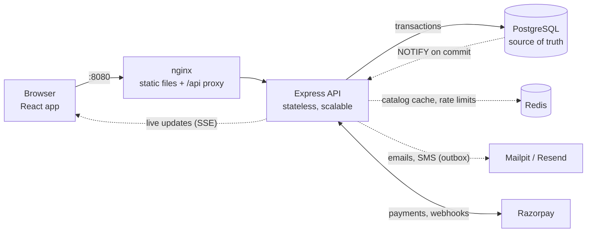

More diagrams (data model, checkout sequence, order state machine): [docs/architecture.md](docs/architecture.md).
Design decisions and their trade-offs: [docs/adr/](docs/adr/).

## Run it

### With Docker (one command)

You need Docker Desktop and Git.
```bash
cp .env.example .env
docker compose up -d --build
docker compose exec -T db psql -U quickkart -d quickkart < db/seed/seed.sql   # sample data, once
```
Open **http://localhost:8080**. Register, then open the test inbox at **http://localhost:8025**
and click the "Confirm your email" link. To use the admin area, run
`bash scripts/make-admin.sh you@example.com` and refresh the page. Riders are added from
Admin → Riders.

Online payments use QuickKart's built-in test gateway until you put Razorpay **test** keys in
`.env` (`RAZORPAY_KEY_ID`, `RAZORPAY_KEY_SECRET`); then Razorpay's real window opens. Pay with
UPI id `success@razorpay`.

| Service | Role | Reachable at |
|---|---|---|
| web | nginx: serves the React app, forwards `/api` | http://localhost:8080 |
| api | Express API; scale with `docker compose up -d --scale api=3` | only through nginx |
| db | PostgreSQL 18, data in the `pgdata` volume | localhost:5432 |
| redis | catalog cache, shared rate-limit counters | inside Docker only |
| mailpit | catches every email and SMS | http://localhost:8025 |
| k6 | load tester | `bash scripts/load-test.sh catalog` or `checkout` |

### For development (live reload)

You need Node.js 24 too.
```bash
cp .env.example .env && cp api/.env.example api/.env
docker compose up -d db
cd api && npm install && npm run dev        # applies migrations, then http://localhost:4000/api/health
docker compose exec -T db psql -U quickkart -d quickkart < db/seed/seed.sql   # sample data, once
cd web && npm install && npm run dev        # http://localhost:5173 (second terminal)
```
Schema changes are numbered files in `api/migrations/`; the API applies new ones when it starts
(or run `npm run migrate`).
Wipe all data and reload the samples: `bash scripts/reset-data.sh`.

### On the internet (Render, free plan)

`render.yaml` describes the whole deployment: one Docker web service (the API also serves
the website), PostgreSQL and Redis. Render dashboard → **New → Blueprint** → this repo, then
fill in the secrets it asks for. Migrations, sample data and delivery slots set themselves
up. Every push to `main` redeploys. Step by step: [docs/batch-c-tasks.md](docs/batch-c-tasks.md);
the trade-offs: [ADR 0011](docs/adr/0011-deploying-as-one-container-on-render.md).

## Tests

```bash
docker compose --profile test up -d db-test   # throwaway test database
cd api && npm test                            # 132 API tests: checkout, payments, riders, outbox, accounts, live, ...
cd web && npm test                            # cart logic
```
Concurrency tests fire 10 simultaneous requests and check the database afterwards.
Redis tests run when a Redis is available: `TEST_REDIS_URL=redis://localhost:6380 npm test`.

<details>
<summary><b>API reference</b></summary>

| Method | Path | Auth | Success | Errors |
|---|---|---|---|---|
| GET | /api/health | – | 200 | 500 |
| POST | /api/auth/register | – | 201 | 400, 409 |
| POST | /api/auth/login | – | 200 | 400, 401 |
| POST | /api/auth/logout | user | 204 | 401 |
| GET | /api/auth/me | user | 200 | 401 |
| GET | /api/stores | – | 200 | |
| GET | /api/categories | – | 200 | |
| GET | /api/stores/:storeId/slots | – | 200 | 400, 404 |
| GET | /api/stores/:storeId/products?q=&category=&limit=&cursor= | – | 200 | 400, 404 |
| POST | /api/orders (header `Idempotency-Key`) | user | 201 | 400, 401, 409, 422 |
| GET | /api/orders | user | 200 | 401 |
| GET | /api/orders/:id | owner | 200 | 401, 404 |
| POST | /api/orders/:id/cancel | owner | 200 | 401, 404, 409 |
| GET | /api/admin/stores/:storeId/inventory | admin | 200 | 401, 403, 404 |
| PATCH | /api/admin/stores/:storeId/inventory/:productId | admin | 200 | 400, 403, 404, 409 |
| POST | /api/admin/stores/:storeId/slots | admin | 201 | 400, 403, 409 |
| GET | /api/admin/orders, /api/admin/orders/:id | admin | 200 | 401, 403, 404 |
| PATCH | /api/admin/orders/:id/status | admin | 200 | 400, 403, 404, 409 |
| GET | /api/admin/reports/sales, /top-products, /slots | admin | 200 | 400, 403 |
| POST | /api/auth/logout-all | user | 204 | 401 |
| GET | /api/stores/:storeId/live | – | 200 (event stream) | 404 |
| GET | /api/orders/live | user | 200 (event stream) | 401 |
| GET | /api/admin/live | admin | 200 (event stream) | 401, 403 |
| GET | /api/products/:id/image | – | 200 | 404 |
| POST, DELETE | /api/admin/products/:id/image (multipart `image`) | admin | 201, 200 | 403, 404, 413, 415 |
| GET | /api/stores/nearest?pincode= or ?lat=&lng= | – | 200 | 400, 404 |
| GET | /api/pincodes/:pincode | – | 200 | 400, 404 |
| GET, POST | /api/me/addresses | user | 200, 201 | 400, 404, 409 |
| PATCH, DELETE | /api/me/addresses/:id | user | 200, 204 | 400, 404 |
| POST | /api/auth/verify-email, /resend-verification | –, user | 200, 202 | 400, 409 |
| POST | /api/auth/forgot-password, /reset-password | – | 202, 204 | 400 |
| POST | /api/orders/:id/payment | owner | 200 | 404, 409, 502 |
| POST | /api/orders/:id/payment/verify | owner | 200 | 400, 404, 409 |
| POST | /api/payments/razorpay/webhook | Razorpay (signed) | 200 | 400 |
| GET | /api/rider/orders, /api/rider/live | rider | 200 | 401, 403 |
| POST | /api/rider/orders/:id/pickup, /deliver | rider | 200 | 404, 409 |
| GET, POST, DELETE | /api/admin/riders | admin | 200, 204 | 403, 404, 409 |

401 = not logged in; 403 = logged in but not allowed; 404 for someone else's order (doesn't
reveal that it exists); 409 = valid request that conflicts with current state; 429 = rate limited.
</details>

<details>
<summary><b>Project structure</b></summary>

```
api/src/
  modules/auth       register, login, sessions (Argon2id, JWT in httpOnly cookie)
  modules/catalog    stores, aisles, slots, search with keyset pagination + cache
  modules/orders     checkout (placeOrder.ts), history, cancel
  modules/admin      inventory, slots, order status, reports
  modules/images     product photos: upload (checked by file bytes), serve with cache headers
  modules/payments   Razorpay + built-in test gateway, verify, webhook, expiry and refund jobs
  modules/location   nearest store (haversine in SQL), pincodes, saved addresses
  modules/rider      rider board, race-safe pickup, delivery
  notifications/     transactional outbox, email and SMS templates, sender job
  db.ts              pool, withTransaction, withRetry
  cache.ts           Redis cache-aside with safe fallback
  live.ts            pg_notify / LISTEN / Server-Sent Events
  jobs.ts            background jobs, one instance at a time (advisory locks)
  migrate.ts         numbered SQL migrations (api/migrations/)
  middleware/        auth (session checked on every request), rate limits
api/test/            Vitest + Supertest, including concurrency tests
web/src/             React app: features (auth, store, cart), pages (shop, checkout, orders, admin)
api/migrations/      the schema, as numbered SQL files
db/seed/             50,000 realistic sample products
load/                k6 scripts: catalog browsing, flash-sale checkout
scripts/             load-test, reset-data, make-admin, try-checkout
docs/                architecture, ADRs, performance, scaling
```
</details>

## What I'd do next

- A real SMS provider; reconcile with Razorpay before expiring an order.
- Automatic rider assignment from live rider locations.
- Split hot stock into buckets for flash sales ([scaling.md](docs/scaling.md)).
