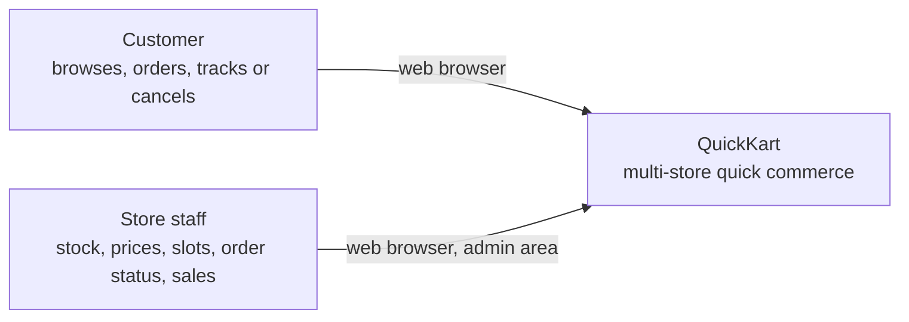
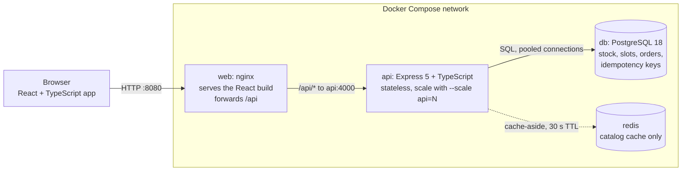
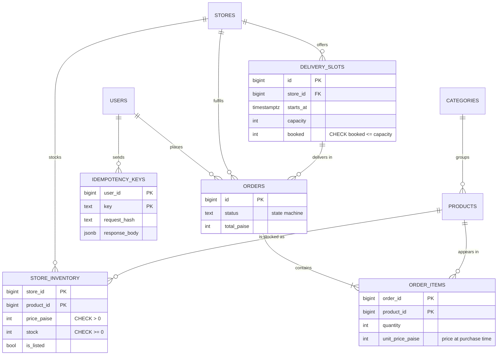
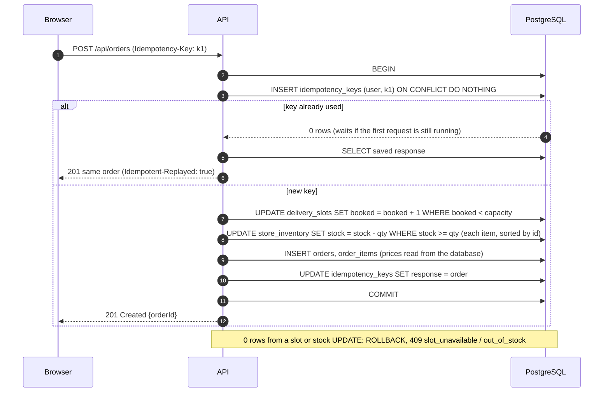
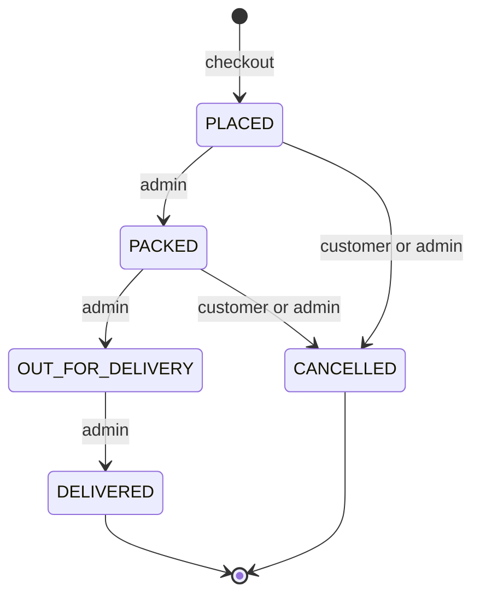

# Architecture

QuickKart is a **modular monolith**: one API codebase with clear internal modules (auth,
catalog, orders, admin), one PostgreSQL database as the single source of truth, and Redis
as a disposable cache. Everything runs with one command through Docker Compose.

The diagrams below follow the C4 model's idea of zoom levels: who uses the system, then
the running pieces, then the most important flow in detail. GitHub draws them from the
text in this file.

## 1. Context: who uses it

## 2. Containers: the running pieces

- **Only nginx is public.** The API has no published port; nginx reaches it by its service
  name `api`. Docker's DNS returns every API container, so nginx spreads requests across them.
- **The API keeps no state in memory.** The login is a signed JWT in an httpOnly cookie, so
  any API container can serve any request. That is what makes horizontal scaling a one-liner.
- **PostgreSQL decides everything that matters**: stock, slot capacity, orders, idempotency.
- **Redis is optional.** If it is down, catalog reads go to PostgreSQL. Checkout never reads it.

## 3. Data model

- **`store_inventory` is the multi-store design.** Price and stock are facts about a
  (store, product) pair, so they live in a junction table keyed by both. Product details
  are stored once.
- **Money is integer paise.** Floating point can't represent 0.1 exactly.
- **Constraints are the last line of defence**: `stock >= 0` and `booked <= capacity` hold
  even if application code has a bug.
- **Order lines copy the price paid**, so later price changes don't rewrite history.

## 4. Checkout: the critical flow

Everything below runs in **one transaction**. Any failure rolls back all of it.

Why each step is safe:
1. **Check inside the write.** `WHERE stock >= qty` is evaluated by the UPDATE itself. A
   concurrent order waits for the row lock, then PostgreSQL re-checks the condition on the
   new value. There is no gap between checking and writing.
2. **Fixed lock order** (slot first, then products by id) prevents deadlocks; `withRetry`
   handles the rare leftover deadlock or serialization error.
3. **Idempotency key in the same transaction** as the order: either both exist or neither.

## 5. Order status: a state machine

Allowed "from" states are checked inside the UPDATE (`WHERE status = ANY(allowed)`), so two
admins clicking at once can't skip a step. Cancelling returns the stock and the slot place
in the same transaction, exactly once.

## 6. Code layout

| Folder | Responsibility |
|---|---|
| `api/src/modules/auth` | register, login, logout, current user |
| `api/src/modules/catalog` | stores, aisles, slots, product search with keyset pagination |
| `api/src/modules/orders` | checkout (`placeOrder.ts`), history, cancel |
| `api/src/modules/admin` | inventory, slots, order status, reports |
| `api/src/db.ts` | connection pool, `withTransaction`, `withRetry` |
| `api/src/cache.ts` | Redis cache-aside with versioned keys and safe fallback |
| `web/src/features` | auth, store picker, cart (reducer + context) |
| `web/src/pages` | shop, checkout, orders, admin dashboard |

These module boundaries are where the monolith could be split later if one part ever needs
to scale or deploy on its own. See [scaling.md](scaling.md) and [ADRs](adr/).
